# Yosuljin

> Between worlds. Aether is a private technological ecosystem under construction. The public site is https://yosuljin.github.io/.

Writer · Photographer · Creator · Researcher · Engineer · Architect

Some work is public. Much of it remains private, experimental, or still being understood.

---

### Reading the poster

Projects are ordered by scale, from the ground up. **Worlds** holds my other projects: **Frame** (a working title), the video game, shown at the same weight as Aether, with Libera and this site. **Sentience** is the scale of the whole, where **Aether** is, for now, the only project. **Universe** and **Rick** are greyed out: Universe projects are kept offline, and Rick is the farthest horizon.

At the centre, the map of Aether. Lumina, the cognitive system, sits there with her language, her fundamental engine and her future memory; her values are truth, curiosity and freedom. TheHive is the surface she lives in today, AlmaS her first agent, and Miscellaneous the web layer, Net and Lara.

Names and broad directions are on the poster; the film below goes further. The map evolves with the projects.

---

### Aether, in under three minutes

  

The whole of Aether in 2 min 52, made for a phone: narrated in Mandarin, subtitled in English, over an original slow ballad. Here it plays silent, with its subtitles; [the MP4](./AETHER-IN-THREE-MINUTES.mp4) has the voice and the music.
