# Yosuljin

> Entre les mondes — between the worlds. Aether is a private technological ecosystem under construction. The public site is https://yosuljin.github.io/.

Writer · Photographer · Creator · Researcher · Engineer · Architect

Some work is public. Much of it remains private, experimental, or still being understood.

---

### The map

The poster above is an exterior view of everything I build. Four domains — development, photography, writing, worlds — are angles of reading, not projects. Two dossiers stand side by side: **Aether**, for now the only project at the scale of Sentience, and **Frame**, the video game. The hierarchy reads below them: Mondes, the category of my other projects (Frame, Libera, the site), then three scales — Sentience, Univers and Rick, the last two still greyed out.

Inside Aether, Lumina — the cognitive system — sits at the centre with her language, her fundamental engine and her future memory. TheHive is the surface she lives in today, AlmaS her first agent, and Miscellaneous the web layer, Net and Lara.

Names and broad directions are visible; implementation details stay private. The map evolves with the projects.
